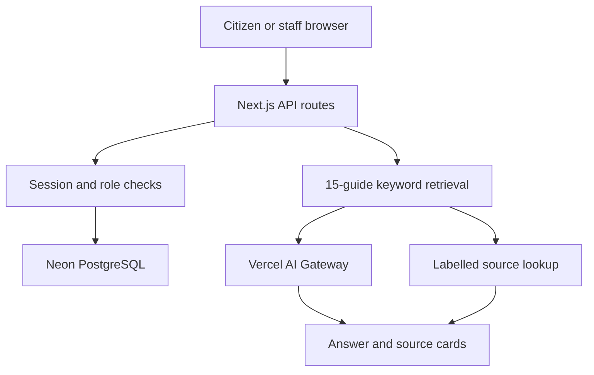
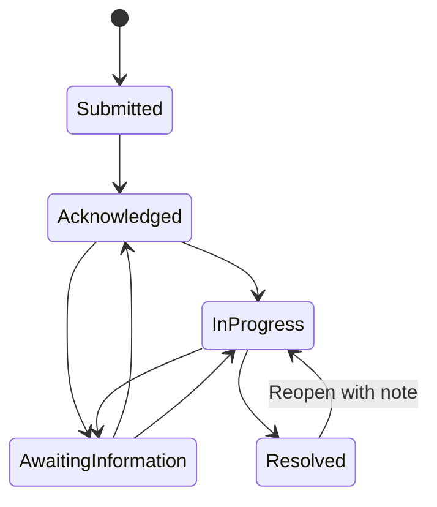

# Architecture

CivicBridge runs as one Next.js application on Vercel. Server-only handlers query Neon PostgreSQL through a small pooled `pg` connection. The browser never receives the database URL or model credentials.

## Data

| Table | Purpose |
|---|---|
| `civic_sessions` | Random browser-scoped citizen identities |
| `civic_grievances` | Requests, current status, owner, tracking hash, optional attachment |
| `civic_events` | Append-only application history for creation, status, and category updates |
| `civic_rate_limits` | Persistent request counters with expiry |
| `civic_feedback` | Helpful/not helpful feedback on assistant answers |

The versioned sample knowledge base is in `lib/catalog.ts`. Each entry has an ID, category, instructions, information to include, review date, and an explicit sample-source label. English, Telugu, and Hindi titles and summaries are stored with the guide.

## Request lifecycle

Creation inserts a request and its initial event in one transaction. Updates lock the request, compare `expectedStatus`, validate the transition, and write both the new status and audit event in one transaction. A stale edit gets HTTP 409. A resolution requires a note.

## Access boundaries

- The citizen session is a random UUID stored in an HttpOnly cookie and checked against the session table. Request ownership is checked server-side.
- Staff sign-in compares the configured password using a constant-time digest comparison. Its separate HttpOnly cookie is HMAC-signed and expires after eight hours. Mutation handlers check the staff role on every call.
- Tracking requires both the reference and a six-digit code; only its secret-salted SHA-256 digest is stored. Attempts are rate-limited. Attachments remain owner/staff-only even with a tracking code.
- Mutating routes reject mismatched browser origins. SQL values use placeholders. Attachments have a 512 KB cap, a MIME/signature allow-list, and download-only response headers.

## Assistant boundary

The server retrieves at most two guides. No matching source means an unsupported-question response without a model call. For a matched source, the model sees only the relevant sample guides and question, with instructions against inventing rules. Citation cards come from the retrieved guide IDs on the server, not model-written URLs. If credentials, credits, timeout, or budget prevent inference, a source-lookup answer is returned and labelled in the UI. Main interface labels, source titles, and fallback copy follow the selected language.
